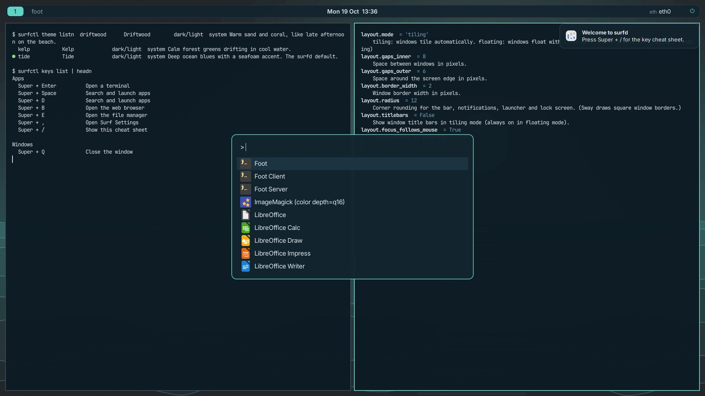
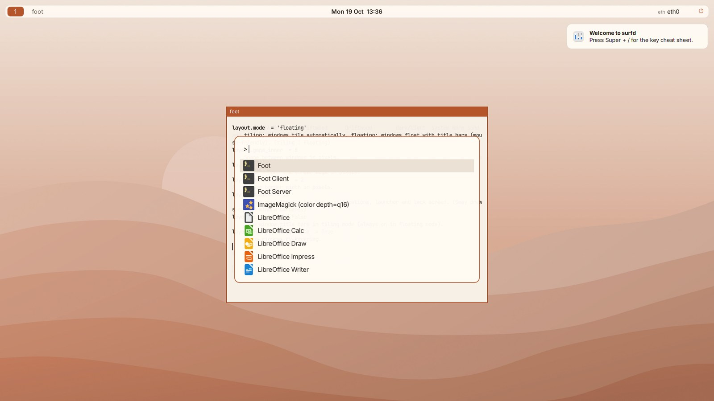
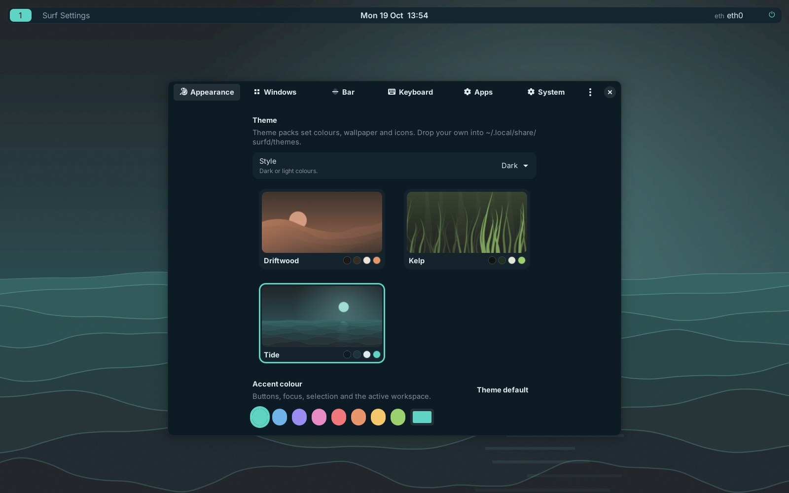

# surfd

**A lightweight, good-looking Sway desktop on Fedora Linux, configured from one file.**

surfd is a Fedora Remix. It is based on Fedora Linux but is **not an official
Fedora project** and is not endorsed by the Fedora Project. Fedora's packages,
kernel and repositories are used unchanged; surfd adds its own release
identity, theme, configuration layer and tools.



| | |
|---|---|
|  |  |
| *Driftwood (light) in mouse-friendly floating mode* | *Surf Settings* |

## What you get

- **A normal Fedora underneath.** `dnf`, Flatpak with Flathub, systemd,
  SELinux enforcing, NetworkManager, PipeWire, CUPS and Bluetooth. Fedora's
  current stable kernel and the full firmware set.
- **Sway, configured for people.** Tiling *and* a mouse-friendly floating
  mode, touchpad gestures, a searchable key cheat sheet on **Super + /**, a
  Wi-Fi picker, a power menu, screenshots to file and clipboard.
- **One config file.** `~/.config/surfd/surfd.toml` controls theme, accent,
  fonts, wallpaper, bar, keys, gaps, corner radius and default apps. You never
  edit raw Sway, Waybar or GTK config.
- **`surfctl`, applied live.** `surfctl theme set kelp`, `surfctl accent '#88c0d0'`,
  `surfctl bar layout left=workspaces center=clock right=tray,audio,power`.
  Invalid changes are refused and nothing is touched; `surfctl reset` keeps a backup.
- **Surf Settings.** A small GTK 4/libadwaita app over the same file, plus a
  first-login Welcome tour.
- **Theme packs are folders.** Three original themes (Tide, Driftwood, Kelp),
  each dark and light, all artwork generated from code (CC BY-SA 4.0). Drop a
  folder in `~/.local/share/surfd/themes/` or `surfctl theme install pack.tar.gz`.
- **One look everywhere.** Waybar, mako, fuzzel, foot, swaylock, GTK 3/4,
  Qt (qt6ct), the greetd login screen and the Plymouth boot splash all follow the theme.
- **`surfd-hwprobe`.** Detects hardware and suggests NVIDIA, Broadcom, SOF
  audio, codec or guest-tool packages, with the exact commands. Installs nothing.

## 30-second tour

```sh
surfctl theme list                       # installed theme packs
surfctl theme set driftwood --variant light
surfctl accent '#e88bc4'                 # or: surfctl accent reset
surfctl wallpaper set ~/Pictures/beach.jpg
surfctl mode floating                    # windows float with title bars
surfctl bar preset minimal
surfctl keys bind Mod+F1 exec foot -e htop
surfctl explain layout                   # every setting with help text
surfctl reset                            # back to defaults (backup kept)
surfctl backups restore latest           # undo that
```

Full reference: [docs/customization.md](docs/customization.md) and
[docs/settings-reference.md](docs/settings-reference.md).

## Get it

There are no published images yet. Build one on Fedora 44:

```sh
sudo dnf install lorax lorax-lmc-novirt anaconda-tui pykickstart rpm-build createrepo_c \
  python3-pytest python3-tomlkit python3-pillow librsvg2-tools desktop-file-utils appstream systemd-rpm-macros
./build.sh rpms            # build surfd's RPMs (runs the test suite)
./build.sh check           # confirm every package exists for Fedora 44
sudo ./build.sh --selinux-permissive iso
```

Or install the desktop onto an existing Fedora 44 system:

```sh
./build.sh rpms
sudo dnf install out/repo/surfd-{default-config,settings,theme,logos,hwprobe}-*.noarch.rpm \
  out/repo/surfctl-*.noarch.rpm out/repo/plymouth-theme-surfd-*.noarch.rpm
# log out and pick "surfd" in your login manager
```

See [docs/build.md](docs/build.md) for every option, including the
netinstall ISO, aarch64, and the experimental atomic (bootc) image. Pushing a
`v*` tag builds both ISOs in GitHub Actions and publishes them with checksums.

## Hardware: an honest note

surfd supports exactly the hardware that Fedora's kernel and `linux-firmware`
support. It ships every open GPU driver (Mesa), all of Fedora's Wi-Fi,
Bluetooth and audio firmware, and the stable kernel, and `surfd-hwprobe` points
you at the rest. "Works on every device" is not something any Linux
distribution can promise. Known limitations:

- **NVIDIA proprietary driver**: available from RPM Fusion; Sway runs on it
  only with `--unsupported-gpu` (surfd adds it automatically). Upstream Sway
  does not support this configuration; the open nouveau driver is the default.
- **Broadcom Wi-Fi chips that need `wl`**: driver from RPM Fusion; needs a
  wired or USB-tethered connection first.
- **Secure Boot**: Fedora's signed shim, GRUB and kernel work. Third-party
  modules (NVIDIA, `wl`) need a one-time key enrollment (MOK). The optional
  mainline kernel is not signed for Secure Boot.
- **Intel IPU6/IPU7 built-in cameras** (many 2021+ laptops): limited support.
- **Very new Wi-Fi/GPU chips** may need the [mainline kernel](docs/hardware.md#mainline-kernel).
- **Fingerprint readers**: only models supported by libfprint.
- **Arm (aarch64)**: UEFI/SystemReady machines only. No Raspberry Pi–specific
  image yet; Apple Silicon is not supported (use Fedora Asahi Remix).
- **Sway itself**: no window animations or rounded window corners (the bar,
  notifications, launcher and dialogs are rounded); X11 apps run through
  Xwayland and may be blurry with fractional scaling; screen sharing goes
  through xdg-desktop-portal-wlr (whole outputs; window picking is limited).

More in [docs/hardware.md](docs/hardware.md).

## Why Sway?

Stable, small and i3-compatible, packaged and maintained in Fedora (there is
an official Fedora Sway spin), with SELinux-friendly packaging. The comparison
with Hyprland and river is in [docs/window-manager.md](docs/window-manager.md).

## Project status

surfd is at 0.1.0. What has been verified, and how:

| Area | Verified | How |
|---|---|---|
| Kickstarts (x86_64 + aarch64) | ✅ | `ksvalidator` F44 and F45, `ksflatten` |
| Shell scripts | ✅ | `shellcheck`, clean |
| surfctl / config / themes / keys / generators / hwprobe | ✅ | 103 pytest tests (+5 GTK CSS tests) |
| Generated Sway config | ✅ | real `sway --validate`, every theme × variant × mode |
| foot, fuzzel, Waybar, mako, GTK 3/4 config | ✅ | `foot --check-config`, live run, GTK CSS parser |
| Whole session look | ✅ | real Sway + Waybar + mako + fuzzel + foot on a headless output |
| Surf Settings / Welcome | ✅ | headless run of every page + 8-step click-through test |
| RPM specs | ✅ | `rpmbuild` of all 5 specs (9 binary RPMs) + `rpmlint` clean |
| Package names exist in Fedora 44 | ⚠️ | not verified here (no Fedora mirror access): run `./build.sh check` (CI does) |
| Building and booting the ISO | ⚠️ | not done yet: see [docs/testing.md](docs/testing.md) |
| Greeter under SELinux enforcing, Anaconda branding, < 400 MB idle RAM, ISO < 1.5 GB | ⚠️ | needs a real boot: see the checklist |

Next steps are in [docs/ROADMAP.md](docs/ROADMAP.md).

## Repository layout

```
build.sh                 build RPMs, live ISO, netinstall ISO, bootc image
kickstarts/              surfd.ks = repos + base + desktop + live (+ per-arch boot)
packaging/specs/         surfd-release, surfd-theme (+logos, plymouth), surfd-default-config
                         (+live), surfctl (+hwprobe), surfd-settings
src/surfctl/             the surfd Python package and surfctl CLI (+ tests)
src/settings/            Surf Settings and Welcome (GTK 4 + libadwaita)
src/hwprobe/             surfd-hwprobe
src/session/             surfd-session and helper scripts
config/                  defaults (surfd.toml), greetd, systemd units, live-session bits
release/                 os-release, presets, dist macros
theme/                   theme packs, SVG logos, artwork generator, Plymouth, Anaconda branding
containers/              experimental bootc Containerfile
docs/                    guides, man pages, screenshots
tools/                   package checks, size/RAM measurement, headless screenshot tests
```

## Licensing

Code: MIT ([LICENSE](LICENSE)). Artwork, themes and documentation: CC BY-SA 4.0
([LICENSES/](LICENSES/)). Every file's license is listed in
[REUSE.toml](REUSE.toml). surfd contains no Fedora logos or trademarks;
`fedora-logos` is replaced by `generic-logos` and `surfd-logos`, and
`fedora-release` by `surfd-release`, following the
[Fedora Remix guidelines](https://fedoraproject.org/wiki/Remix). "Fedora" is a
trademark of Red Hat, Inc.

Contributions are welcome. Start with [CONTRIBUTING.md](CONTRIBUTING.md).
