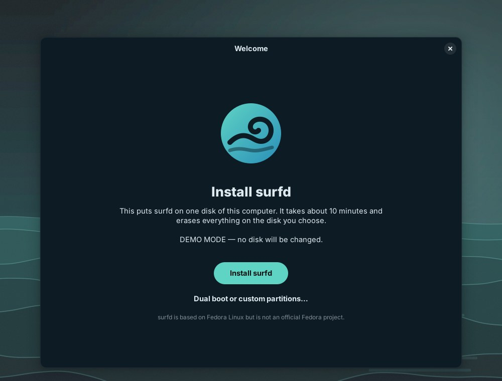
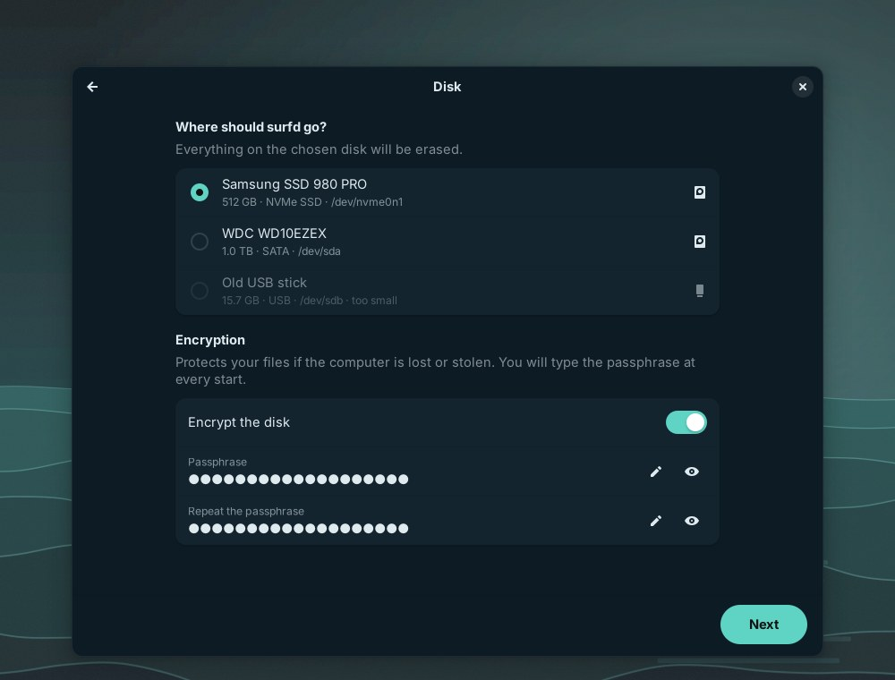
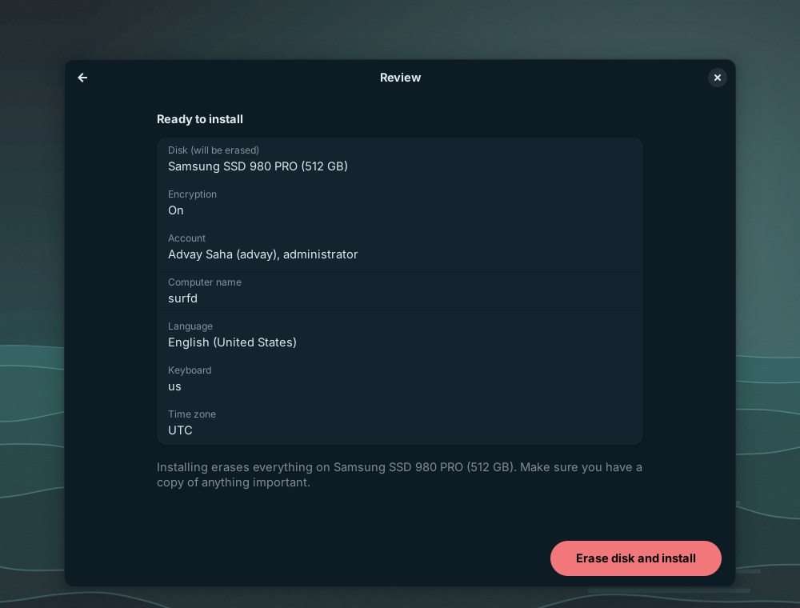
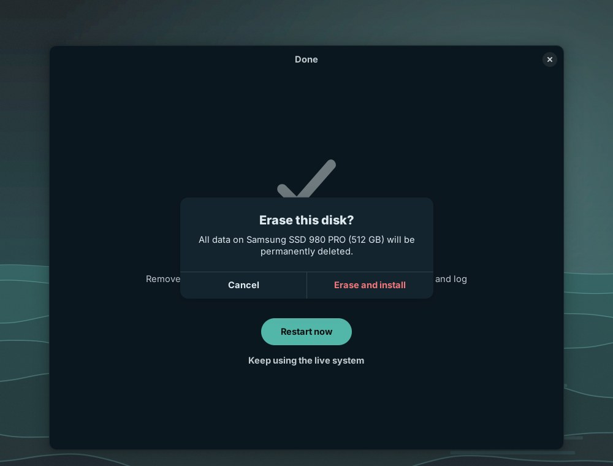

# Surf Installer

The simple way to put surfd on a computer: five screens, about ten minutes.

|  |  |
|---|---|
|  |  |

1. **Welcome**: *Install surfd*, or *Dual boot or custom partitions…*, which opens
   Fedora's full installer (Anaconda).
2. **Language and keyboard**: language, keyboard layout (applied immediately,
   so you type your password with the right layout) and time zone.
3. **Disk**: pick one disk; it will be **erased**. The USB stick you started
   from is never offered. Optional full-disk encryption (LUKS2).
4. **Account**: your name, username (suggested from your name), password,
   computer name. You become the administrator (`wheel`); root is locked.
5. **Review**: everything on one page, then *Erase disk and install* and a
   final confirmation.

Then a progress bar (with a *Details* log), and *Restart now*.

## What it builds

| Partition | Size | Format |
|---|---|---|
| EFI system partition (UEFI) / BIOS boot (legacy BIOS) | 600 MiB / 1 MiB | vfat / — |
| `/boot` | 1 GiB | ext4 |
| everything else | rest of the disk | btrfs with `root` and `home` subvolumes, zstd compression — inside LUKS2 if encrypted |

This mirrors Fedora's own default layout. The system is copied from the live
image (`/run/rootfsbase`, the untouched image, not your live-session changes)
with `rsync`. Then the installer:

- writes `fstab`, `crypttab`, `/etc/kernel/cmdline` and `/etc/default/grub` by UUID
- sets language, keyboard (console + login screen), time zone, hostname and a fresh machine-id (`systemd-firstboot`)
- keeps the Wi-Fi networks you joined in the live session
- removes live-only pieces (`surfd-live`, the installer itself, the live user's sudo rule)
- creates your account
- builds the initramfs and boot entries (`kernel-install`) and installs GRUB, using Fedora's signed shim on UEFI (Secure Boot works) with a firmware boot entry named "surfd"
- relabels the new system for SELinux

The log is at `/tmp/surf-installer.log`; the installer can copy it to your
home folder if something goes wrong.

## When to use Fedora's full installer instead

Dual boot with Windows or another Linux, keeping existing partitions, RAID,
LVM, a custom layout, or installing to more than one disk. The Welcome
screen's *Dual boot or custom partitions…* button opens it.

## How it is put together

```
src/installer/surf_installer/
  app.py      the GTK 4 / libadwaita wizard (runs as the live user)
  plan.py     the choices + validation; passed to the engine as a 0600 JSON file it deletes after reading
  engine.py   the install steps (runs as root via sudo on the live system, or pkexec)
  disks.py    which disks are offered
```

The wizard and engine talk through JSON lines on stdout (`progress`,
`done`, `error`). The engine can be run by hand:

```sh
sudo /usr/libexec/surfd/surf-installer-engine --plan plan.json --dry-run   # print every command, change nothing
```

`plan.json` fields: `disk`, `encrypt`, `passphrase`, `fullname`, `username`,
`password`, `hostname`, `timezone`, `locale`, `keyboard_layout`,
`keyboard_variant`, `firmware` (`auto`/`uefi`/`bios`), `root_fs`
(`btrfs`/`ext4`).

## Tests

- `src/installer/tests/test_engine.py`: plan validation, disk filtering,
  partition naming, every generated file, and the exact command sequence for
  UEFI/BIOS × plain/encrypted (dry run). Secrets never reach the log.
- `src/installer/tests/test_loop_install.py` (root): a real install onto a
  24 GB loop-device disk — partitioning, formatting, mounting, copying (links
  kept, live-only files excluded), fstab UUIDs checked against the real disks
  — plus the LUKS2 header and passphrase. Variants needing btrfs, vfat or
  device-mapper run where the kernel has them.
- `tools/installer-screenshot.sh`: drives the real wizard in demo mode
  (`SURF_INSTALLER_DRY_RUN=1`) through every screen, including wrong input.

What only a real boot can prove — GRUB, the initramfs, Secure Boot, the
encrypted boot prompt and SELinux labels — is in the
[testing checklist](testing.md#install-with-surf-installer).
